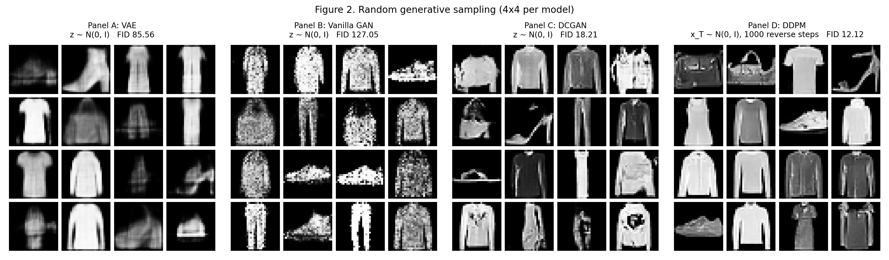
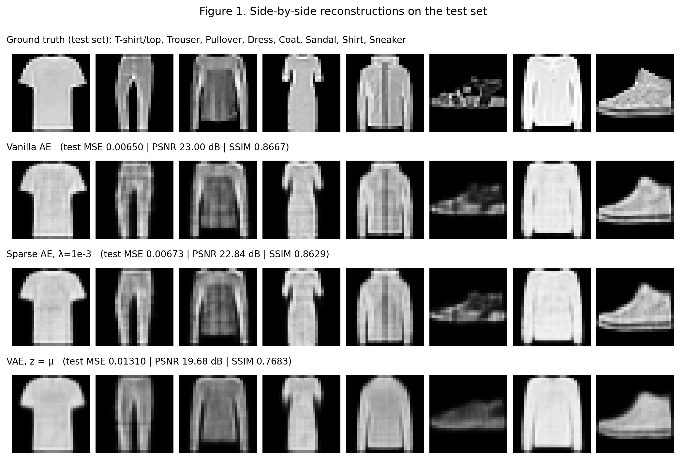
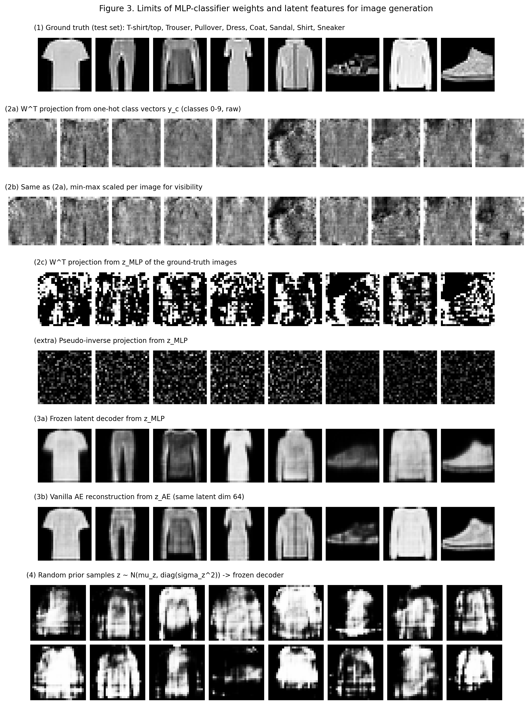
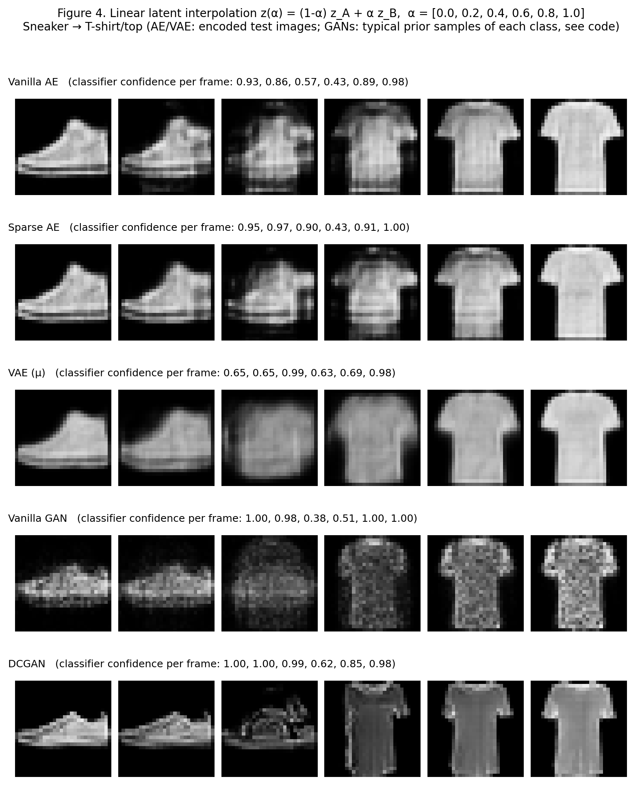
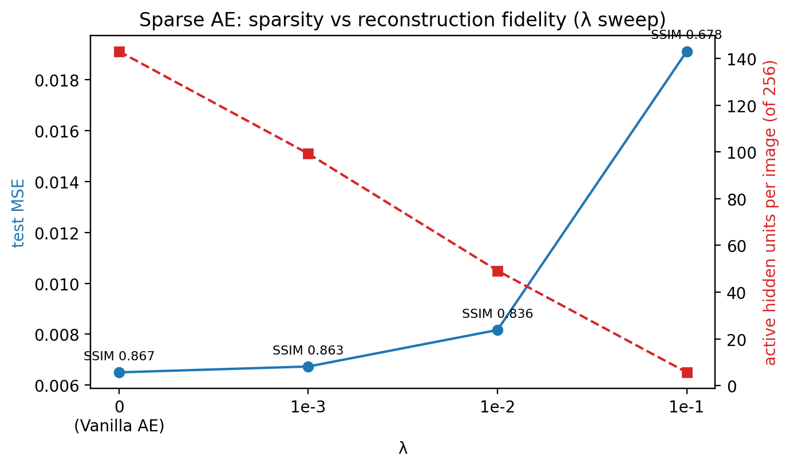
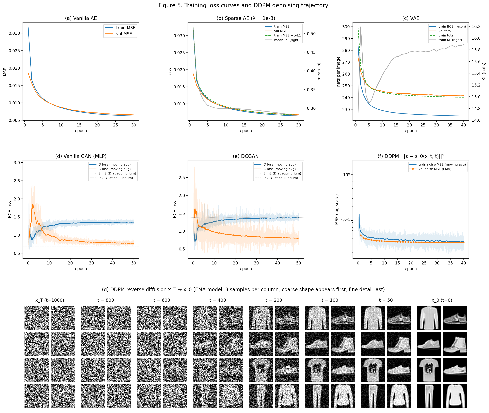

# Comparative Study of Generative Models on Fashion-MNIST

An empirical comparison of six generative architectures (**Vanilla AE, Sparse AE, VAE, Vanilla GAN, DCGAN and DDPM**), all trained from scratch in PyTorch under one standardised setup. The study also includes an experiment showing why the weights and latent features of a discriminative **MLP classifier** cannot be reused for image generation.



## Key results

All metrics are on the held-out **test set**. Training time and latency were measured on an NVIDIA T4 (Google Colab).

| Model | Latent dim | Train time / epoch (s) | Latency (ms / batch 64) | Test MSE ↓ | PSNR (dB) ↑ | SSIM ↑ | FID ↓ |
|---|---|---|---|---|---|---|---|
| Vanilla AE | 64 | 7.4 | 0.35 | **0.00650** | **23.00** | **0.867** | N/A |
| Sparse AE (λ = 1e-3) | 64 (256 sparse) | 7.3 | 0.23 | 0.00673 | 22.84 | 0.863 | N/A |
| VAE | 64 | 7.1 | 0.18 | 0.01310 | 19.68 | 0.768 | 85.56 |
| Vanilla GAN (MLP) | 100 | 12.8 | 0.23 | N/A | N/A | N/A | 127.05 |
| DCGAN | 100 | 27.5 | 10.93 | N/A | N/A | N/A | 18.21 |
| DDPM (T = 1000) | 28×28 | 70.5 | 47,937 | N/A | N/A | N/A | **12.12** |

*FID: 5,000 generated vs 5,000 real test images, InceptionV3 pool features (torchmetrics). The FID between two sets of real images (val vs test) is **5.24**, which is the best achievable at this sample size.*

### Findings

- **The generative trilemma, measured.** DDPM gives the best FID (12.1) and stable training, but generating 64 images takes **48 s**, about 4,400× slower than the DCGAN (11 ms). The DCGAN is the best quality-per-millisecond trade-off.
- **FID ranks texture noise below blur.** The MLP GAN's samples are sharp but full of speckle noise, and its FID (127) is *worse* than the blurry VAE (86). Convolution (DCGAN) removes the speckle and brings FID down to 18.
- **Latent voids, quantified.** Sampling a Gaussian fitted to the deterministic AE latents gives FID **209** (Vanilla AE) and **193** (Sparse AE), against **86** for the VAE with the same decoder. The KL term is what makes the latent space sampleable.
- **Sparsity is cheap until it isn't.** Raising the L1 penalty takes the active hidden units from 143 → 99 → 49 → 6 per image, while MSE stays almost flat up to λ = 1e-3 and then roughly triples by λ = 1e-1.
- **Classifier features are not generative.** An MLP classifier (89.2% test accuracy) with the same 784→256→64 shape as the AE encoder cannot be inverted (Wᵀ ≠ W⁻¹, and ReLU destroys information). A decoder trained on its frozen features loses within-class detail, and Gaussian samples from its latent space decode into blobs.

## Figures

| | |
|---|---|
| **Fig. 1 – Reconstructions**  | **Fig. 3 – MLP classifier limits**  |
| **Fig. 4 – Latent interpolation**  | **Sparse AE λ sweep**  |

**Fig. 5 – Training curves and DDPM reverse diffusion**


## Standardised setup

| Setting | Value |
|---|---|
| Dataset | Fashion-MNIST, train + test merged (70,000 images) |
| Split | 56,000 / 7,000 / 7,000 (80/10/10), fixed with `torch.Generator().manual_seed(42)` |
| Seed | 42 for `random`, `numpy` and `torch` |
| Batch size | 128 |
| Pixel range | [0, 1] for AE / Sparse AE / VAE / MLP; [-1, 1] for GAN / DCGAN / DDPM |
| Optimisers | Adam 1e-3 (AEs, VAE, MLP); Adam 2e-4, β₁ = 0.5 (both GANs); AdamW 2e-4 + EMA (DDPM) |

## Models

| Model | Architecture | Loss |
|---|---|---|
| Vanilla AE | MLP 784→256→64→256→784 | MSE |
| Sparse AE | Same shape, L1 penalty on the 256-unit hidden code | MSE + λ‖h‖₁ |
| VAE | MLP encoder → (μ, log σ²) ∈ ℝ⁶⁴, same decoder as the AE | BCE + KL(q(z\|x) ‖ N(0, I)) |
| Vanilla GAN | MLP G (100→256→512→1024→784), MLP D with dropout | Non-saturating BCE |
| DCGAN | Transposed-conv G and strided-conv D, BatchNorm, N(0, 0.02) init | Non-saturating BCE |
| DDPM | U-Net (28→14→7, self-attention at 7×7), linear β schedule, T = 1000 | ‖ε − ε_θ(x_t, t)‖² |
| MLP classifier | 784→256→64→10 with dropout | Cross-entropy |

## Reproduce

```bash
pip install -r requirements.txt          # install PyTorch with CUDA first (pytorch.org)
python data.py                           # download data, check the split

python -m train.train_mlp                # MLP classifier
python -m train.train_ae                 # Vanilla AE
python -m train.train_sparse_ae --lam 1e-3
python -m train.train_vae
python -m train.train_gan --arch mlp     # Vanilla GAN
python -m train.train_gan --arch dcgan   # DCGAN
python -m train.train_ddpm               # DDPM (resumable)

python -m experiments.mlp_limitations    # MLP classifier experiment, Figure 3
python -m evaluation.evaluate_all        # FID, latency, coverage, results table
python -m figures.make_figures           # Figures 1, 2, 4, 5
```

Optional λ sweep: `python -m train.train_sparse_ae --lam 1e-2 --name sparse_ae_lam1e-2` (and the same with `1e-1`).

## Project structure

```
data.py              dataset loading and the fixed split
utils.py             seeding, device, json helpers
models/              ae, sparse_ae, vae, gan, dcgan, ddpm, mlp
train/               one training script per model family
experiments/         MLP classifier limitation experiment
evaluation/          reconstruction metrics; FID, latency and coverage
figures/             figure generation
results/             metrics and training histories (json), final_table.md
outputs/             figures and sample grids
```

## Limitations

- **Short DDPM training:** 40 epochs (~17.5k steps), far fewer than in the original paper, so its FID is an upper bound.
- **FID setup:** 28×28 grayscale images are upsampled for an ImageNet-trained Inception network with 5k samples. Absolute values are not comparable to published numbers; the ranking within this study is what matters.
- **Mode coverage check:** it uses an MLP classifier with 89% accuracy, so it only detects collapse *between* classes, not within a class.
- **Single seed:** GAN results especially can vary between seeds.
